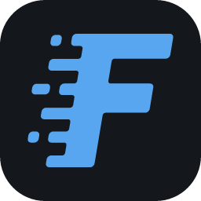

<div align="center">



# FreeToken Desktop

**Manage local language models from your desktop.**

[](https://snapcraft.io/freetoken-desktop)
[](https://snapcraft.io/core24)

[](https://snapcraft.io/publisher/sidaliteir)


[Getting Started](#getting-started) · [Configure](#configure) · [Limitations](#limitations) · [Build](#build) · [Support](#support) · [License](#license)

Unofficial snap packaging for [FreeToken Desktop](https://www.flashml.ai/), a control panel for local language models and inference.

</div>

---

## Getting Started

<a href="https://snapcraft.io/freetoken-desktop"></a>

```bash
sudo snap install freetoken-desktop
freetoken-desktop
```

Use **Install** in the application to download its engine, then download a model and start it. Local inference requires a supported NVIDIA GPU and driver; the engine and models need several gigabytes of free disk space.

The [freetoken](https://snapcraft.io/freetoken) snap provides a separate CLI and background service; this desktop installs its own engine.

## Configure

Configure the engine and models in the application. Settings, downloads and caches stay in `~/snap/freetoken-desktop/common` across snap updates.

For models on removable storage:

```bash
sudo snap connect freetoken-desktop:removable-media
```

## Limitations

- Linux amd64 only. Host coding agents and tools cannot be launched from the confined application.
- GPU kernels outside upstream's precompiled coverage may require a CUDA compiler, which is not included.
- Update the desktop with `sudo snap refresh freetoken-desktop`; its built-in desktop updater cannot replace snap files. Engine updates remain available through the application.
- The desktop source and redistribution license are not provided with the upstream download; the recipe uses its official `.deb`.

## Build

```bash
git clone https://github.com/sidalit/freetoken-desktop-snap.git
cd freetoken-desktop-snap
sudo snap install snapcraft --classic
snapcraft pack
```

Builds use the pinned desktop release; there is no desktop HEAD build without public source.

## Support

- **Installation or snap issues:** [open a packaging issue](https://github.com/sidalit/freetoken-desktop-snap/issues).
- **Application bugs:** [report them upstream](https://github.com/FlashML-org/FreeToken/issues).

## License

Snap packaging: [MIT](LICENSE).
